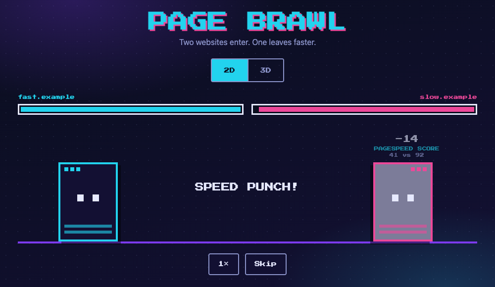
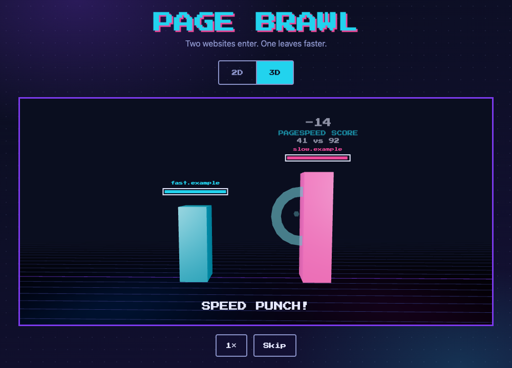
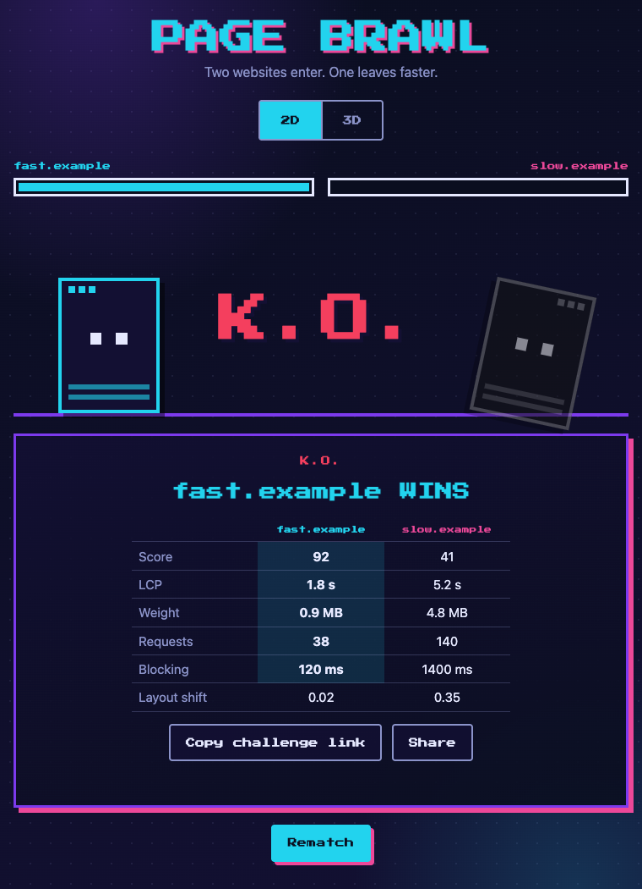

<div align="center">

# Page Brawl

**Two websites enter. One leaves faster.**

A tiny browser game where two real websites fight each other with their real performance metrics.
Paste two URLs, watch the match in retro **2D** or in a low-poly **3D** arena, and find out whose page is the
heavyweight champion.

[Live demo](#live-demo) · [How a match works](#how-a-match-works) · [Run it locally](#run-it-locally) · [Deploy](#deploy-vercel)




</div>

## Live demo

<!-- TODO: add the production URL here, e.g. https://page-brawl.vercel.app -->

Until it is deployed, run it locally: it takes a minute and needs no API key ([see below](#run-it-locally)).

## Features

- **Real data.** Metrics come from Google PageSpeed Insights (mobile, performance category): score, LCP, page weight,
  requests, Total Blocking Time and Layout Shift.
- **Two views, one match.** A retro pixel **2D** view and a **3D** arena (React Three Fiber). Switch between them
  at any time, even mid-match: the match never restarts or desyncs.
- **Readable hits.** Every hit tells you what the defender lost on ("PAGESPEED SCORE · 41 vs 92"), with damage and
  critical hits.
- **Shareable.** A result card made for screenshots, a **challenge link** (`?a=<url>&b=<url>`) that starts the same
  fight for whoever opens it, and a Share button (Web Share API with a clipboard fallback).
- **Deterministic.** No randomness anywhere: the same two sites always produce the same fight.
- **Fast and accessible.** Lighthouse mobile on the production build: **100 / 100 / 100 / 100**
  (performance, accessibility, best practices, SEO). The 3D view is lazy-loaded, respects
  `prefers-reduced-motion`, and is disabled with a message when WebGL is unavailable.
- **No tracking.** No database, no auth, no analytics, no cookies.

## How a match works

Both sites start with **100 energy**. There are always **six rounds**, one per metric:

| Round | Move          | Metric                       | Wins   |
|-------|---------------|------------------------------|--------|
| 1     | Speed Punch   | Performance score            | higher |
| 2     | Paint Kick    | Largest Contentful Paint     | lower  |
| 3     | Heavy Slam    | Total page weight            | lower  |
| 4     | Request Combo | Number of network requests   | lower  |
| 5     | Freeze Ray    | Total Blocking Time (TBT)    | lower  |
| 6     | Shake Quake   | Cumulative Layout Shift (CLS)| lower  |

The better value in a round wins it and hits the other fighter. The bigger the gap, the harder the hit
(up to 25 damage); a gap of 60% or more is a **critical hit** (×1.25). Equal values are a block.

- Reach 0 energy and it is a **K.O.**: the match ends on the spot (the earliest possible K.O. is round 4).
- Otherwise the fighter with more energy wins on **decision**; ties go to the higher performance score, and a
  perfect tie is a **draw**.
- TBT and CLS sit near zero on good sites, so their gaps are measured against Lighthouse's "good" thresholds
  (200 ms and 0.1): 10 ms vs 20 ms of blocking time is a scratch, not a knockout.

The exact formulas and five worked examples live in [`docs/GAME_RULES.md`](docs/GAME_RULES.md); each example is a
unit test.

<div align="center">

</div>

## Run it locally

Requires **Node 20+**.

```bash
git clone https://github.com/matteocardini/pagebrawl.git
cd pagebrawl
npm install
cp .env.example .env.local
npm run dev
```

Open [http://localhost:5173](http://localhost:5173). By default the app runs in **mock mode**: it never calls Google
and uses four fake sites, so you can try everything without an API key.

### Mock mode: what you see

| You type                                                                  | You get                                           |
|---------------------------------------------------------------------------|---------------------------------------------------|
| `fast.example`, `slow.example`, `average.example`, `bloated.example`      | That fake site's fixed numbers                    |
| Anything else (e.g. `github.com`)                                         | One of the four fake sites, chosen by a stable hash of the name. **The numbers are not the real site's.** |

The "analyzing" screen is a fixed 1.5 s in mock mode. Nothing is random: the same input always gives the same match.

To force mock mode regardless of your `.env.local`:

```bash
VITE_USE_MOCK=true npm run dev
```

### Using real data

1. Create a PageSpeed Insights API key. In the [Google Cloud console](https://console.cloud.google.com/), create or
   pick a project, enable the **PageSpeed Insights API**, then create an **API key** and restrict it to that API.
   (If the "Create credentials" menu only offers OAuth and service accounts, use the **Get a Key** button in the
   [PageSpeed Insights API guide](https://developers.google.com/speed/docs/insights/v5/get-started), or
   `gcloud services api-keys create --api-target=service=pagespeedonline.googleapis.com`.)
2. Put it in `.env.local` (this file is git-ignored, never commit it):
   ```
   PSI_API_KEY=your-key
   VITE_USE_MOCK=false
   ```
3. Run the app with the Vercel CLI so the `/api/analyze` function is served next to the frontend:
   ```bash
   npx vercel dev
   ```
   The first run asks you to log in and link a Vercel project. `npm run dev` only serves the frontend, so with
   `VITE_USE_MOCK=false` it cannot reach the API.

A real analysis takes **10 to 50 seconds** depending on the site. The loading screen keeps animating and says
"taking longer than usual" after 20 s. The function gives up after 55 s with a friendly timeout message.
The key only ever lives on the server: the browser calls `/api/analyze?url=...`.

## Scripts

| Command              | What it does                             |
|----------------------|------------------------------------------|
| `npm run dev`        | Vite dev server                          |
| `npm run build`      | Typecheck + production build             |
| `npm run preview`    | Serve the production build               |
| `npm run test`       | Vitest, run once                         |
| `npm run test:watch` | Vitest in watch mode                     |
| `npm run lint`       | ESLint                                   |
| `npm run typecheck`  | TypeScript, no emit                      |

Before a release: `npm run typecheck && npm run lint && npm run test && npm run build`.

## How it is built

**Stack:** Vite · React 18 · TypeScript (strict) · three.js with React Three Fiber and drei · Vitest · plain CSS.
No Redux, no UI kit, no Tailwind, no database.

```
src/
├─ engine/        pure TypeScript: rules, types, runMatch()  (fully unit-tested)
├─ data/          fixtures for mock mode, API client, URL normalisation
├─ state/         useMatch (input → loading → result), usePlayback (timers), view mode, share helpers
├─ views/
│  ├─ view-2d/    retro pixel view
│  └─ view-3d/    React Three Fiber arena (lazy-loaded)
├─ components/    URL form, view toggle, result card, loading and error screens
└─ styles/        design tokens (CSS variables)
api/analyze.ts    Vercel serverless function: PageSpeed Insights proxy
docs/             rules, architecture, roadmap, decisions log
```

```
URL form ─► useMatch ─► fetchMetrics ×2 (parallel) ─► runMatch(a, b) ─► MatchResult
                                                                           │
                                                           usePlayback (owns the timers)
                                                                           │
                                                      PlaybackState ─► View2D  or  View3D
```

Design rules that keep it tidy:

- **The engine is pure.** No React, no DOM, no Three.js, no `Math.random`, no `Date.now`: same input, same output.
  `runMatch` has 100% branch coverage.
- **Views contain no game logic.** Both only render the `PlaybackState` they receive, so they play identically and
  switching views can never restart or alter the match.
- **Match state lives above the views.** Playback timers belong to the app layer; a view switch only swaps the child.
- **The API key never reaches the browser.** `api/analyze.ts` validates the URL (http/https only, no localhost or
  IP addresses), calls PageSpeed, maps failures to clear error codes and sets cache headers.

More detail: [`docs/ARCHITECTURE.md`](docs/ARCHITECTURE.md) (structure, API contract, view contract) and
[`docs/NOTES.md`](docs/NOTES.md) (a log of the decisions taken along the way).

## Deploy (Vercel)

1. Import the repository in Vercel (framework preset **Vite**, build command `npm run build`, output `dist`).
2. In *Project Settings → Environment Variables* add `PSI_API_KEY` (server only, **no** `VITE_` prefix). Leave
   `VITE_USE_MOCK` unset (or `false`) in production: only the exact value `true` switches to fake data.
3. Deploy. `vercel.json` sets the `/api/analyze` function to a 60 s `maxDuration`. If your plan caps it lower,
   lower it too (the function itself gives up after 55 s).
4. In `index.html`, replace the placeholder domain `page-brawl.vercel.app` (`og:url`, `og:image`,
   `twitter:image`) with your real one so link previews work.

## Accessibility and motion

The view toggle is a keyboard-accessible `aria-pressed` control with visible focus states; energy bars expose
`role="progressbar"`; each hit is announced to screen readers. With `prefers-reduced-motion` there is no screen
shake or flashing in either view and no camera sway in 3D.

## Credits

- Pixel font [Press Start 2P](https://fonts.google.com/specimen/Press+Start+2P), self-hosted via Fontsource.
- Performance data from [Google PageSpeed Insights](https://developers.google.com/speed/docs/insights/v5/about).
- Built with [three.js](https://threejs.org/) and [React Three Fiber](https://docs.pmnd.rs/react-three-fiber).

## License

MIT © Matteo Cardini
